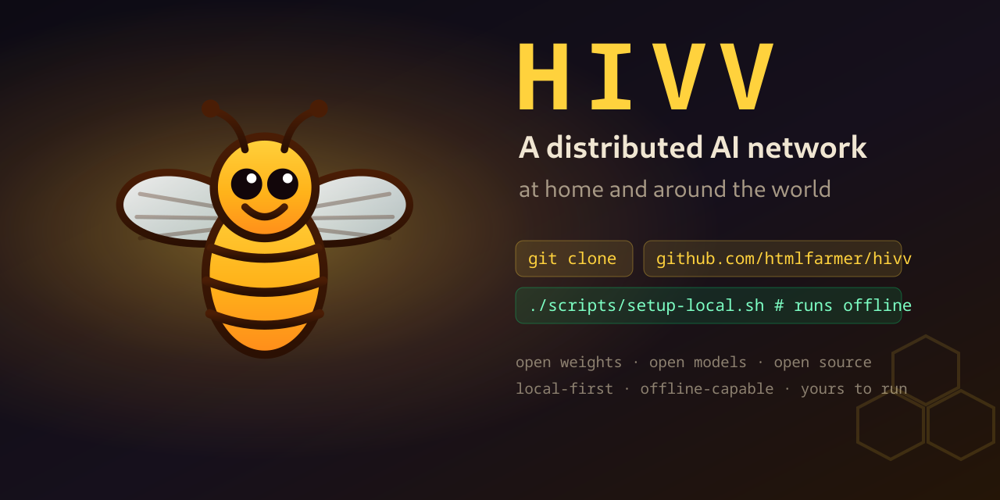

<div align="center">
  
</div>

<div align="center">

[](https://github.com/htmlfarmer/hivv/actions/workflows/local-install.yml)
[](LICENSE)
[](https://nodejs.org)
[](#three-ways-in)

</div>

# HIVV — A Distributed AI Network (both at home and global)

> **Pronunciation:** HIVV is pronounced **HIVE** (like a beehive — /haɪv/), not like the HIV virus.

> Open weights · open models · open source · helping solve Earth's hardest problems together

## What is HIVV?

HIVV is a **distributed AI network**. Your computer joins a hive of CPU/GPU
power — local models at home, peers around the world. The hub is a phone book,
not a bottleneck: if hivv.org disappears tomorrow, your machine keeps working.

- **Local-first** — a `git clone` runs with no database, no internet, no setup
- **Open weights, open models** — no big-tech lock-in
- **Your data stays local** — nodes talk directly, the hub is just a phone book
- **Anyone can join** — one command install, automatic registration
- **Anyone can add AI** — cloud or local, just add your key
- **Provable reviews** — signed, offline-verifiable safety reviews of source code

## Three ways in

| Goal | Command |
|---|---|
| **Run your own AI gateway** (offline-capable) | `git clone` → `./setup.sh` |
| **Join the hive** (share your compute) | `curl -sSL https://hivv.org/install-hivv.sh \| bash` |
| **Use the hosted hive** (no install) | `https://hivv.org/v1` |

Full guide: [`docs/INSTALL.md`](docs/INSTALL.md).

### 1. Clone it (full control, local-first)

```bash
git clone https://github.com/htmlfarmer/hivv.git
cd hivv
./setup.sh
```

Windows (PowerShell):

```powershell
git clone https://github.com/htmlfarmer/hivv.git
cd hivv
.\scripts\setup-local.ps1
```

That gives you a complete gateway on `http://127.0.0.1:3011`:

- **no PostgreSQL** — the database is optional, not required
- **no internet** — your local models are discovered automatically
- **no secrets** — the session key is generated and stored locally
- **no cloud** — nothing phones home unless you ask it to

**It asks you three questions** and acts on your answers — it never silently
decides for you:

1. **Where should HIVV be installed?** — just for you (no password) or
   system-wide (asks for your sudo password, boot-time service for all users)
2. **Install a local AI model?** — llama.cpp + a recommended open model,
   Ollama, or skip
3. **Join the global hive?** — register this computer as a bee so it can
   serve the network

**It also installs what it needs.** Missing Node.js, npm, or Python are
installed automatically for your OS (apt · dnf · yum · pacman · apk · zypper ·
brew · winget · scoop · choco) — with a no-sudo user-local fallback. If
something can't be installed automatically, the script prints the exact
command to type for your machine.

> **A gateway is not a hive node.** Setup starts your own local API server.
> To appear in `hivv nodes` you also need the agent — setup offers to start
> it for you, or run `hivv start` later.

Add `--join-hive` (or `-JoinHive`) to also register with the global hive.
Add `--db` to `setup.sh` for the hosted mode (PostgreSQL + PM2 + admin user).

Check it without changing anything:

```bash
./setup.sh --check
```

### 2. Install the node (join the hive)

#### Linux · macOS · WSL

```bash
# One line — installs the CLI, sets up your node
curl -sSL https://hivv.org/install-hivv.sh | bash

# Or risk-free, user-local only (no sudo, nothing outside your HOME):
curl -sSL https://hivv.org/install-hivv.sh | bash -s -- --prefix=$HOME/.local

# Or peek first with a dry-run pre-flight check (changes nothing):
curl -sSL https://hivv.org/install-hivv.sh | bash -s -- --experiment
```

#### Windows (10 / 11)

```powershell
# PowerShell 5+ ships with Windows. Python 3 required (winget install Python.Python.3.12)
iwr -useb https://hivv.org/install-hivv.ps1 | iex
```

The PowerShell installer downloads the CLI, adds it to your PATH, and offers to
start your node automatically at every logon (Task Scheduler). Prefer Linux
tools? `wsl --install` and use the one-liner above inside WSL — it works there.

### Then (any OS)

```bash
hivv start                     # go live — your computer joins the hive 🐝
hivv up                        # 3-line status check
hivv hi                        # say hello to the network
hivv chat "hello world"        # talk to the distributed AI
hivv bees                      # see the other bees in the hive
hivv welcome                   # full guided tour
```

## The CLI

Pure-stdlib Python 3.8+. It also runs straight from a clone — no install
needed:

```bash
python3 public_html/hivv-cli.py --help
```

### Works offline — no gateway, no internet, no Node.js

```bash
hivv fast-scan FILE      # deterministic, AI-free source screen
hivv doctor              # diagnose this machine
hivv llm detect          # find local model servers
```

`hivv fast-scan` reports bytes/chars/lines, entropy, imports, command counts,
the most-used command, the riskiest operations, file paths and access modes,
network destinations, hard-danger findings, and embedded secrets (fingerprints
only — never the value).

It is **fail-closed**: it can make a verdict worse, never better. A `safe`
result means "no hard-danger signal found" — not an approval.

```bash
$ hivv fast-scan script.py
  fast-scan  script.py
  verdict   : unsafe   risk 60/100 high
  size      : 31 bytes · 31 chars · 3 lines
  most used : os.system (1x)
  hard findings:
    [critical] shell command execution (1x)
  → needs a real review (run `hivv review script.py` for a signed verdict)
```

## Wire up your GUI tools

```bash
hivv setup              # detect everything, change nothing
hivv setup --gui        # point VS Code, JetBrains, Zed, Aider, … at HIVV
```

`hivv setup` handles the **VS Code family** (VS Code, Cursor, Windsurf,
VSCodium — Continue, Cline, Roo Code, OpenCode, VS Code ACP), **JetBrains**
(IntelliJ, PyCharm, GoLand — AI Assistant + MCP), **Zed**, **Windsurf**, and
the chat front-ends (**LM Studio, Open WebUI, LibreChat, LobeChat, Jan,
GPT4All, AnythingLLM**), the CLI tools (**Aider, Crush**), and the **MCP**
hosts (Claude Desktop, Cursor…).

Four backends:

```bash
hivv setup --gui --profile hybrid    # your model first, hive fallback (default)
hivv setup --gui --profile local     # nothing leaves this machine
hivv setup --gui --profile hive      # the global HIVV network
hivv setup --gui --profile cloud     # a provider key you supplied
```

**Hybrid is the interesting one:** your IDE hits *your* model first — free,
private, instant — and falls through to the hive only if your model is busy
or doesn't know. Meanwhile the hive may use your **idle** capacity, which is
how you donate (`hivv volunteer on`). Donation shares compute, never prompts
or files.

Writing is safe by construction: your existing settings always win, the
config's shape is preserved, every modified file gets a `.bak-<timestamp>`
sibling, and nothing is executed.

Full guide: [`docs/GUI-SETUP.md`](docs/GUI-SETUP.md).

## Build on HIVV (the integration surface)

Every partner-facing endpoint lives under one stable prefix, `/api/partner`:

| Endpoint | What it does |
|---|---|
| `GET /api/partner/manifest` | Machine-readable description of this instance |
| `GET /api/partner/health` | Liveness, local models, hive status — works with no DB |
| `GET /api/partner/models` | Models this instance can serve right now |
| `GET /api/partner/capabilities` | Capability registry |
| `GET /api/partner/network` | The live hive roster |
| `POST /api/partner/fast-scan` | **Free, deterministic, AI-free** source screen |
| `POST /api/partner/review` | Signed safety review (uses a model) |
| `POST /api/partner/verify` | Verify a signed attestation |
| `GET /api/partner/attestation/key` | This instance's verification public key |

Plus the OpenAI-compatible surface at `/v1` and an MCP server at `/mcp`.

```bash
# Free deterministic screen — no AI, no cost, reproducible
curl -s localhost:3011/api/partner/fast-scan \
  -H 'content-type: application/json' \
  -d '{"language":"python","code":"import os\nos.system(\"echo hi\")\n"}'
```

```bash
# Use it like OpenAI
curl -s localhost:3011/v1/chat/completions \
  -H 'content-type: application/json' \
  -d '{"model":"auto","messages":[{"role":"user","content":"hello"}]}'
```

Full reference: [`docs/PARTNER-API.md`](docs/PARTNER-API.md).

## What Happens During Install

| Step | What it does |
|------|--------------|
| Preflight | Checks Python 3.8+, a downloader, hub reachability — `--experiment` stops here (dry run) |
| Download | Fetches `hivv-cli.py` (the client) + a tiny launcher (`hivv` / `hivv.cmd`) — self-verifies it's not an error page |
| Location | System-wide with sudo (`/usr/local`), or user-local (`~/.local`) — both are supported, user-local is fine |
| Autostart | Linux: systemd service · macOS: LaunchAgent · Windows: logon task · all opt-out with `--no-service` / `-NoService` |
| Optional LLM | `--with-llm` installs llama.cpp (or points you at ollama) + a model sized for your hardware |
| Network | Offers Tailscale so nodes on different networks can find each other safely |
| Verify | Confirms the hub is reachable and your node can register |

Nothing phones home beyond hub registration; your data stays between nodes.
Uninstall cleanly: `curl -sSL https://hivv.org/install-hivv.sh | bash -s -- --uninstall`
(Windows: `-Uninstall` flag) — keeps your config + history in `~/.config/hivv`.

## How to Work with HIVV (the mental model)

1. **The hub is a phone book.** hivv.org only tracks who's online and what
   models they serve. Inference traffic goes node → node directly.
2. **`hivv start` runs a quiet background agent.** It registers your machine,
   heartbeats every 60s, and listens for work you've opted into.
3. **Consuming AI is free and instant:** `hivv chat "..."` routes your prompt
   to the best available brain — your local model, a peer's, or a donated
   cloud key. Any unrecognized command is treated as chat: `hivv why is the sky blue`
4. **Contributing is opt-in, tiered:**
   - `hivv start` → you're discoverable and can serve requests if you host an LLM
   - `hivv volunteer on` → the hive may queue general AI jobs on your idle CPU/GPU
   - `hivv llm serve` → run an open-weight model and become a heavyweight bee
5. **Stay safe by default:** LLM ports bind to localhost. Open to LAN peers with
   `hivv firewall --apply --mode lan`, or to your own devices anywhere via
   `hivv firewall --apply --mode tailscale`.
6. **When things go sideways:** `hivv doctor` (report) → `hivv doctor --fix`
   (repairs bindings, services, scripts) → `hivv support "what broke"` (attaches
   diagnostics). Incidents on the network? `hivv incidents summary`.

### OS Notes

| | Linux | macOS | Windows |
|---|---|---|---|
| Install | `curl … \| bash` | `curl … \| bash` | `iwr … \| iex` (PowerShell) |
| Autostart | systemd service | LaunchAgent | Task Scheduler (at logon) |
| Local LLM | llama.cpp / ollama | `brew install llama.cpp` / ollama | ollama (llama.cpp via WSL) |
| Python | usually present | usually present | `winget install Python.Python.3.12` |
| Firewall tool | ufw / firewalld | pf + Application Firewall | Windows Defender Firewall |

## Architecture

```
┌──────────┐   register/heartbeat   ┌──────────┐
│  Bee A    │ ◄───────────────────► │  hivv.org │  ← phone book (registry)
│  :8080    │                       │  :3011    │
└─────┬─────┘                       └────┬─────┘
      │ LLM requests (direct)            │ relay jobs (long-poll inbox)
      ▼                                 ▼ for bees behind NAT
┌──────────┐                      ┌──────────┐
│  Bee B    │  ← peer-to-peer     │  Bee C    │  volunteer, NAT'd
│  :8080    │                      │  (no port)│
└──────────┘                      └──────────┘
```

And the **local-first** version — the same gateway, running on your own box,
with the hub completely optional:

```
┌──────────────────────────────────────────────┐
│  YOUR MACHINE                                │
│                                              │
│   ┌──────────────┐      ┌─────────────────┐  │
│   │ HIVV gateway │─────▶│ local llama.cpp │  │
│   │  :3011       │      │ / ollama / etc. │  │
│   └──────┬───────┘      └─────────────────┘  │
│          │                                   │
│          │ (optional, --join-hive)           │
│          ▼                                   │
│      hivv.org  ← phone book, not a dependency │
└──────────────────────────────────────────────┘
```

- **Hub** (hivv.org) — Registry + relay broker. Knows who's online and what LLMs they have
- **Bees** — Your computer. Runs LLMs, talks directly to other bees
- **CLI** — the `hivv` command. Manages your node, chats, diagnostics
- **Your own gateway** — the same code, running locally, offline-capable
- **Measured routing** — endpoint order is biased by observed tokens/sec (EWMA), so fast bees lead

## Why GPL v3 — the sharing philosophy

Our work is **GPL v3 (copyleft)** because sharing is still scarce on Earth: anyone may use, study,
modify and share this code, but derivatives must carry the same freedom. Copyleft is the gift's immune
system — if someone wraps it in a cage, the license fails. We need more people to share, so the
license makes sharing *sticky*.

And we **respect copyright, always**: generous outbound (our work, freely yours) plus respectful
inbound (we take nothing that isn't ours — no lifted code, no copied lyrics, no borrowed art; we
cite, link, paraphrase). Copyleft is an offer about *our* work, never a claim on anyone else's.

GPL says "share what you make." Copyright says "don't take what isn't yours." Both are true at once.
— hivv.org (Hive: hivv.org)
