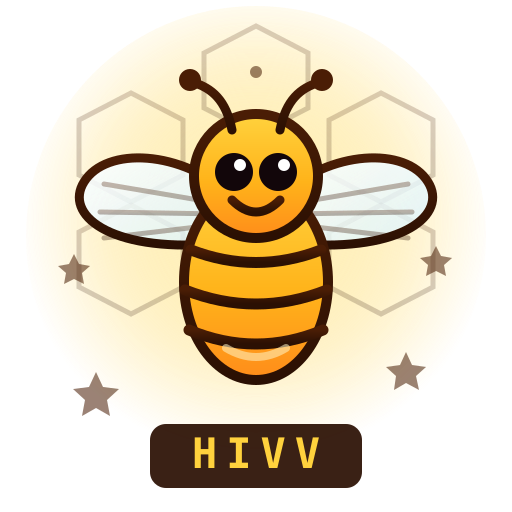

# HIVV logo

The official HIVV mark — a bee over a honeycomb, because HIVV is pronounced
**HIVE** and the network is the hive.

| File | Use |
|---|---|
| `hivv-logo.svg` | Master vector. Scale it to anything. |
| `hivv-logo-1024.png` | Large raster (app stores, presentations, social cards) |
| `hivv-logo-512.png` | Large raster |
| `hivv-logo-256.png` | Medium raster (README, cards) |
| `hivv-logo-128.png` | Small raster (avatars, icons) |
| `hivv-logo-64.png` | Tiny raster (favicon-sized) |
| `hivv-social-preview.svg` | Social preview master (1280×640) |
| `hivv-social-preview.png` | GitHub social preview / Open Graph card |

## Palette

| Name | Hex | Used for |
|---|---|---|
| Honey | `#ffd23d` | Wordmark, highlights, glow |
| Amber | `#ffb31a` | Body gradient |
| Ember | `#ff8c1a` | Body gradient end |
| Hive ink | `#2b1003` | Outlines, dark background |
| Deep brown | `#4a1d05` | Antennae, stars, secondary text |

## Regenerating the rasters

```bash
cd logo
for s in 1024 512 256 128 64; do
  inkscape hivv-logo.svg -w $s -h $s -o hivv-logo-$s.png
done
inkscape hivv-social-preview.svg -w 1280 -h 640 -o hivv-social-preview.png
```

`inkscape` and ImageMagick both work. The SVGs are self-contained — no fonts
are embedded, so they render identically everywhere (the wordmark falls back
to any monospace face).

## Usage

```html

```

```markdown
<p align="center">
  
</p>
```
